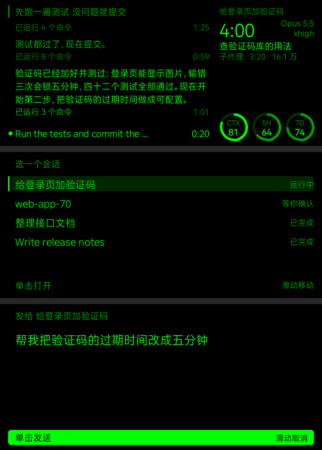

# QwenGlass-Claude：在千问 AI 眼镜上看 Claude Code 干活，用语音给它发指令



<sub>从上到下：运行中、选会话、语音草稿。在本地模拟器里渲染，模拟器和千问开放平台的页面预览用同一个渲染内核；会话是编的示例。</sub>

电脑上开着的 Claude Code 会话，在眼镜上能看到它说了什么、跑到哪一步、用了多久、额度还剩多少；对着眼镜说一句话，单击一下，就发进那个会话。

不用改 Claude Code 的设置，也不用它单独登录。桌面版的 Code 标签和终端里的 `claude` 都能接。

## 能做什么

| | |
|---|---|
| 选会话 | 列出电脑上正在运行的会话和状态：运行中、等你确认、已完成 |
| 看回复 | 回复按眼镜原生字体排好分页，镜腿滑动立即翻页 |
| 看进度 | 运行中左边是时间流：你说的话、它的回复、每组命令的用时、正在跑的工具；右边是总用时、模型和思考强度、子代理和后台任务（没有任务时显示它的计划） |
| 看额度 | 三个圆环：上下文、5 小时限额、7 天限额。限额要装仓库里的小 mod |
| 语音发指令 | 说的话先变成草稿，单击才发；会话还没收到时显示「排队中」。任务没跑完也能接着发 |
| 语音调亮度 | 「亮度五」「亮度调到八十」「亮一点」「暗一点」，直接调眼镜本身的亮度，不进草稿 |
| 菜单栏图标 | Mac 上看连没连上、眼镜在看哪个会话；断开一分钟弹通知；能暂停接收眼镜的指令 |

## 怎么工作

```text
眼镜 ── 千问开放平台 ──wss──► 云端服务 ◄──wss── Mac 上的桥接程序 ── 本机的 Claude Code 会话
```

- 平台的「Agent 自定义接入」用 WebSocket 连到你服务器上的云端服务，服务把画面数据推给眼镜页面。
- Mac 上的桥接程序主动连出去，Mac 不用开端口。它读 `~/.claude/sessions/` 里的会话记录和每个会话的记录文件，把变化同步给云端。
- 发指令是写进会话自己的收件箱 socket。这是 Claude Code 的内部格式，文档里没有，是我们在 2.1.309 上看出来的，Claude Code 升级后可能要跟着改。
- 会话收到的指令算同伴发来的消息，不算你本人：它会照着做，但不能替你批准权限请求，那个还是要回电脑上点。

| 路径 | 内容 |
|---|---|
| `glassclaude/` | Python 源码。云端是 `server.py`、`hub.py`、`panel.py`、`layout.py`、`text.py`、`hearing.py`（语音识别）；Mac 这边是 `bridge.py`、`sessions.py`、`transcript.py`、`inbox.py`、`menubar.py` 等 |
| `pages/claude-panel/` | 眼镜页面 `template.xml` 和 Mock 数据 `data.json` |
| `mod/` | 把上下文和限额写到本地文件的 Claude Code mod |
| `deploy/` | `Dockerfile`、`compose.yaml` 和反向代理配置示例 `site.conf` |

代码注释里提到的 `docs/research.md`、`tests/`、`tools/fake_platform.py` 是开发用的，没有放进这个仓库。

## 部署指南

要准备这些：

- 一台 Mac，装好 Claude Code（桌面版或命令行都行）、Python 3.12 和 [uv](https://docs.astral.sh/uv/)。只在 macOS 上测过，Linux 大概能跑，Windows 不支持。
- 一台公网服务器和一个 HTTPS 域名，装好 Docker。平台和 Mac 都从公网连进来，`wss://` 要有正规证书（Let's Encrypt 就行）。
- 一个[千问开放平台](https://device.qianwen.com)账号，开通「自定义接入」；通信方式用「音频流」的话还要开通音频流。
- 一副千问 AI 眼镜 S1，固件按官方文档的要求升级。

### 第一步：部署云端服务

1. 在仓库根目录复制 `.env.example` 为 `.env`，至少填两个 Token：`GLASSCLAUDE_AGENT_TOKEN`（给平台）和 `GLASSCLAUDE_BRIDGE_TOKEN`（给 Mac），各一串随机字符，比如 `openssl rand -hex 24` 生成。其他几项看文件里的说明，语音识别在第四步填。
2. 启动：

   ```bash
   cd deploy && docker compose up -d --build
   ```

   服务只监听本机的 `127.0.0.1:8790`，根文件系统只读，内存上限 128 MB，不存任何数据：状态都在内存里，重启后 Mac 重连时全量同步。
3. 把 `deploy/site.conf` 加进你已有的 HTTPS 站点：`upstream` 放在 `server` 块外面，三个 `location` 放进 `server` 块。服务挂在 `/claude/` 下面，`/claude/agent` 和 `/claude/bridge` 是 WebSocket，要转发 `Upgrade` 和 `Authorization`。
4. 打开 `https://你的域名/claude/healthz`，返回 `{"ok":true}` 就通了。

### 第二步：在 Mac 上运行桥接程序

1. 装依赖。`--extra mac` 是菜单栏图标要用的 rumps：

   ```bash
   uv sync --extra mac
   ```

2. 新建 `~/.config/glassclaude/env`，权限设成 600，写两行：

   ```text
   GLASSCLAUDE_CLOUD=wss://你的域名/claude/bridge
   GLASSCLAUDE_BRIDGE_TOKEN=和服务器 .env 里同一个
   ```

3. 先看看能不能读到会话：

   ```bash
   uv run glassclaude sessions
   ```

4. 装成登录自启的菜单栏程序：

   ```bash
   uv run glassclaude install-agent
   ```

   菜单栏出现 👓🟢 就是连上了；👓🟠 是刚断开、正在重连，👓🔴 是断开超过一分钟。日志在 `~/Library/Logs/glassclaude-bridge.log`。用 Bartender 之类整理菜单栏的话，新图标可能被收进隐藏区。

   - 程序崩了 launchd 会拉起来；菜单里点「退出」就停着，到下次登录才再启动。卸载用 `uv run glassclaude uninstall-agent`。
   - 它开着时电脑不会自动休眠（合上盖子拦不住）。Mac 睡着了，眼镜上就显示电脑离线。
   - 不想要菜单栏，也可以在终端里跑 `uv run glassclaude bridge --keep-awake`，环境变量自己 export。两个不要同时开，会抢连接。

5. 装限额 mod（可选）。5 小时和 7 天限额只有 Claude Code 自己知道，这个 mod 在每轮结束和限额变化时，把上下文和限额写到 `~/.claude/glassclaude/usage/<会话 ID>.json`。它只写这个文件，不联网，不改对话。不装的话 5H、7D 两个环是空的。

   ```bash
   claude plugin marketplace add "$PWD/mod"
   ```

   ```bash
   claude plugin install glassclaude-usage@glassclaude --scope user
   ```

   装之后新开的会话才会加载。要支持 mod 的 Claude Code（我们用的是 2.1.309）。只装了桌面版的话，`claude` 不在 PATH 上，在 `~/Library/Application Support/Claude/claude-code/<版本>/<哈希>/claude.app/Contents/MacOS/claude`。

### 第三步：在千问开放平台上配置

在平台上是一个 Agent 插件，加上平台为它自动生成的同名 Skill。仓库里的文件这样放：

| 仓库里的文件 | 放到平台上的哪里 | 怎么放 |
|---|---|---|
| 无 | Agent 插件 | 在网页上填表，见下面第 1 步 |
| `pages/claude-panel/template.xml` | 关联 Skill 的 `Pages/claude-panel/template.xml` | 新建页面 `claude-panel`，整篇复制粘贴，保存 |
| `pages/claude-panel/data.json` | 同一个页面的 Mock 数据 | 复制粘贴，只用来预览 |
| 无 | 关联 Skill 的 `SKILL.md`、`tool_schema.json` | 平台按插件的名称和描述自动生成，不用改 |

**1. 新建 Agent 插件**

打开「资源库 → Agent 插件 → 导入 Agent 插件」，「Agent 平台」下拉里有「自定义接入」就是开通了；没有的话，按官方文档里的联系方式找平台开通。然后填：

| 字段 | 填什么 |
|---|---|
| 插件名称 | `Claude 连接器` |
| 插件描述 | 见下面。平台靠名称和描述决定你说的一句话要不要进这个插件 |
| Agent 平台 | 自定义接入 |
| WebSocket 地址 | `wss://你的域名/claude/agent` |
| 认证方式 | Bearer Token，填服务器 `.env` 里的 `GLASSCLAUDE_AGENT_TOKEN`，只填 Token 本身 |
| 通信方式 | 音频流（默认，要做完第四步）；或者 ASR文本，见下面的对比 |
| 连接超时 | 保持默认 |

插件描述可以这样写：

> 在眼镜上查看电脑上 Claude Code 会话的回复和进度，并用语音给会话发指令。只在用户说“打开克劳德”时使用。

语音识别出来的是中文“克劳德”，不是英文 Claude，所以唤醒说法用中文写。

**两种通信方式**

服务两种都支持，按每次连接的通信方式自己区分，可以各建一个插件连同一个服务。一个插件只能选一种。

| | 音频流（默认） | ASR文本 |
|---|---|---|
| 谁来识别 | 平台把声音推给服务，服务转给你配置的识别接口 | 平台自己的识别，把文字推给服务 |
| 要不要额外配置 | 要：开通音频流，填第四步的识别接口 | 不要 |
| 识别的话 | 你说的每一句 | 平台会滤掉它认为是闲聊的句子，有些指令到不了服务 |
| 费用 | 识别接口按秒计费，服务只推说话的那几段 | 不用另付识别费 |

**2. 在关联 Skill 里加页面**

创建插件后，平台会自动生成一个同名 Skill。在插件详情页的「关联 Skill」点「编辑」进去，不要自己另建 Skill：

1. 在左侧的 `Pages` 里新建页面 `claude-panel`，把 `template.xml` 粘进去，保存。
2. 把 `data.json` 粘进这个页面的 Mock 数据。右侧选「千问 AI 眼镜 S1」能预览。
3. 页面说明写 `claude-panel`。服务靠这个词找页面，找不到就用第一个页面。

**3. 真机测试**

1. 在「设备管理」里添加眼镜，打开开发者模式。
2. 在关联 Skill 的编辑器顶部点「真机测试」，选你的眼镜。
3. 对眼镜说“打开克劳德”。

自己用不需要发布：插件和 Skill 都是草稿时，绑定了测试的眼镜就能用。真要发布的话，范围选「个人私有」；插件发布后就锁定了，连 Token 都改不了，只能删了重建。

**4. 只允许自己的眼镜**

第一次连上后，在服务器上看容器日志，找 `眼镜会话 ...：设备 '...'` 这一行，把引号里那串写进 `.env` 的 `GLASSCLAUDE_ALLOWED_DEVICES`，再重建容器。同一段日志里 `用页面 ...` 后面的数字可以填进 `GLASSCLAUDE_TEMPLATE_ID`：服务重启后平台重连时有时不带页面列表，这时就用它。

```bash
docker logs --tail 50 -f glassclaude
```

### 第四步：语音识别（音频流）

通信方式选「音频流」时，服务要自己把声音转成文字。它用的是 OpenAI GA 版 Realtime 的转写会话（`intent=transcription`），在 `.env` 里填：

```text
GLASSCLAUDE_ASR_URL=wss://网关地址/v1/realtime?intent=transcription&model=模型名
GLASSCLAUDE_ASR_KEY=识别接口的 Key
```

我们只测过一种：AxonHub 网关转阿里云百炼的 `paraformer-realtime-v2`。这条路只收 24 kHz（服务会从眼镜的 16 kHz 升上去），按秒计费，约 60 秒收不到声音就断开。

- 服务自己判断开口和说完：安静 0.8 秒就让识别马上出这一句，不等网关断句。真机上说完到出字一般 2～4 秒，长句 6～10 秒。
- 只推说话的那几段，安静的时候不推，不为静音付钱。
- 周围吵、老是误识别，就把 `GLASSCLAUDE_ASR_GATE`（判断开口的响度门限，默认 400）调大。

配好以后重建容器。日志里有 `自己的识别：已配置` 就对了。

## 眼镜上的操作

| 操作 | 看回复 | 运行中 | 选会话 | 草稿 |
|---|---|---|---|---|
| 前滑 / 后滑 | 下一页 / 上一页，最后一页再往后滑看进度 | 翻时间流 | 移动光标 | 取消草稿 |
| 单击 | 打开会话列表 | 打开会话列表 | 选中这个会话 | 发送 |
| 双击 | 底部提示「再双击一次退出」，再双击退出 | 同左 | 同左 | 同左 |

说话不用唤醒词，会话里麦克风一直开着。任何一句话都只变成草稿，单击才发，旁人的话不会误发；草稿越说越长，显示最后几行。会话列表开着时不弹草稿。

30 分钟没有单击或滑动，服务会结束这次会话，麦克风才会关。说话不算操作。

## 安全

- 能连上这个服务的眼镜，就能往你电脑上的 Claude Code 会话里发指令，而会话能在你电脑上跑命令。两个 Token 不要外泄，并且一定要设 `GLASSCLAUDE_ALLOWED_DEVICES`。
- 平台文档说设备 ID（`identity.deviceOpenId`）可能缺省。真遇到没有设备 ID 的连接，这条白名单就拦不住，要另想办法。
- 菜单栏里的「暂停接收眼镜指令」打开后，眼镜发来的话一律不进会话，眼镜上提示「电脑上暂停了」，看回复照常。
- 服务的日志里有会话名和你说的话，不要把日志贴到公开的地方。
